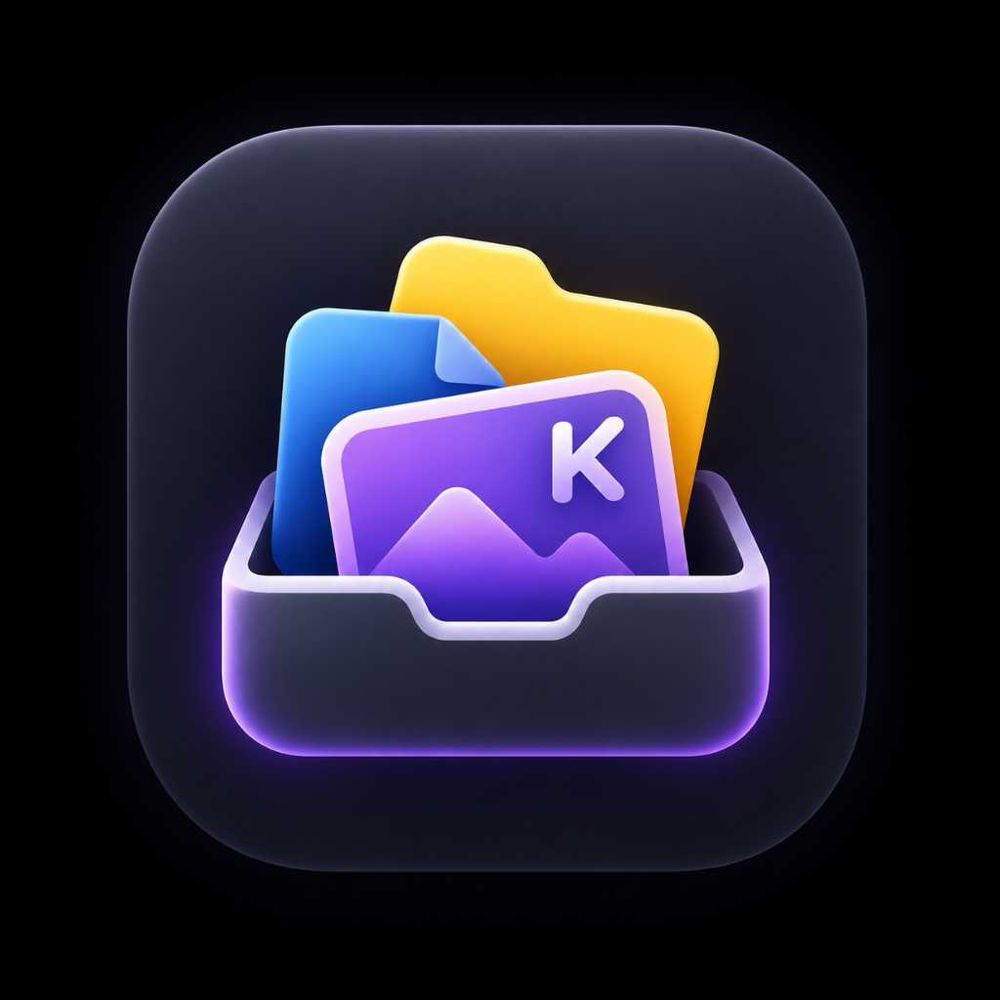
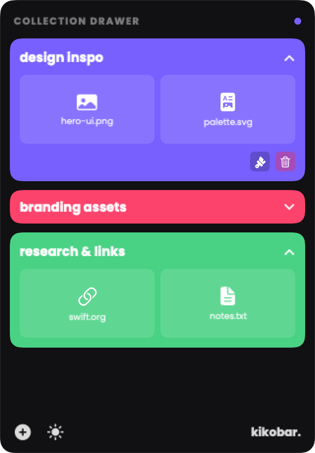
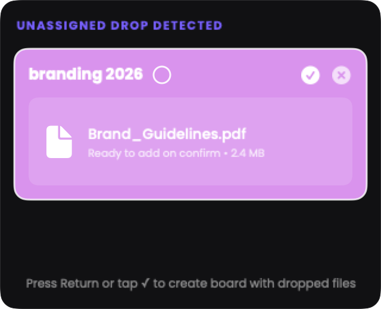
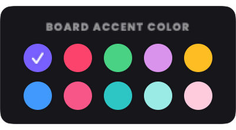
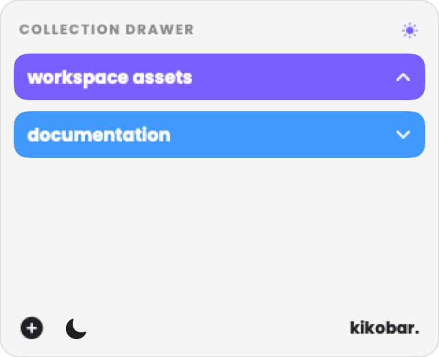
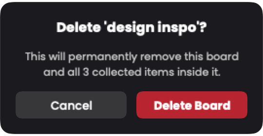

<p align="center">
  
</p>

<h1 align="center">Kikobar</h1>

<p align="center">
  <strong>Your digital collection drawer.</strong><br>
  A simple way to collect anything from anywhere on your Mac.
</p>

<p align="center">
  <a href="Releases/Kikobar-v0.1.0-alpha.zip"></a>
  
  
  
  
  
</p>

---

## What is Kikobar?

**Kikobar** is a native macOS drag-and-drop collection utility designed to eliminate temporary desktop clutter and disjointed file transfers. It provides a lightweight, persistent floating collection drawer that stays hidden until you need it.

Whenever you drag files, images, browser links, or text snippets towards the top-right corner of your screen, Kikobar smoothly reveals an organized collection drawer. Drop items into customized color-coded boards, preview media with native macOS QuickLook, or drop files directly into empty sidebar space to spin up a new board on the fly.

> [!NOTE]
> **Status: Alpha (v0.1.0-alpha)**  
> Kikobar is actively developed. The core ingestion engine, floating window architecture, SQLite persistence, and UI are fully functional. Feedback, issue reports, and community contributions are warmly welcomed!

---

## ⚡️ Quick Download & Install (Alpha)

The compiled, notarized-ready Alpha release is pre-packaged and available directly in the repository:

| Version | Package | Minimum OS | Architecture |
| :--- | :--- | :--- | :--- |
| **v0.1.0-alpha** | [**Download Kikobar-v0.1.0-alpha.zip**](Releases/Kikobar-v0.1.0-alpha.zip) | macOS 14.0+ | Apple Silicon & Intel |

### One-line Installation:
```bash
# Unzip and move to Applications
unzip Releases/Kikobar-v0.1.0-alpha.zip -d /Applications/
open /Applications/Kikobar.app
```

---

## 📸 Feature Walkthrough

### 1. Floating Collection Drawer & Expandable Boards
Smooth slide-out panel anchored to your display edge. Color-coded boards hold your collected assets with live item counters, inline action menus, and thumbnail previews. Drag items straight out into any app, Finder folder, or Slack conversation.

<p align="center">
  
</p>

---

### 2. Automatic Board Creation on Drag-and-Drop
Drop a file (or multiple files) anywhere on an empty area of the sidebar. Kikobar instantly initiates an inline board creation dialog, preserving your dropped payloads and assigning them immediately upon confirmation.

<p align="center">
  
</p>

---

### 3. Circular Color Palette & Board Customization
Personalize your workspace with a 10-shade curated color selector. Clean popovers let you assign distinct visual identities to each collection board.

<p align="center">
  
</p>

---

### 4. Adaptive Dark & Light Themes
Carefully crafted design language tailored for modern macOS. Seamlessly switch between the default dark charcoal theme (`#161618`) and clean daylight mode (`#F7F7F9`).

<p align="center">
  
</p>

---

### 5. Safe Board Management & Deletion
Thoughtfully designed deletion modal confirms the removal of boards and coordinates clean cascading cleanup in the local SQLite database.

<p align="center">
  
</p>

---

## How It Works

```
 ┌──────────────────────┐
 │ 1. Drag Any Content  │  (Finder files, browser images, text, links)
 └──────────┬───────────┘
            │
            ▼
 ┌──────────────────────┐
 │ 2. Move to Top-Right │  (Zero-permission edge trigger detects cursor proximity)
 └──────────┬───────────┘
            │
            ▼
 ┌──────────────────────┐
 │ 3. Drawer Reveals    │  (Floating non-activating NSPanel slides in smoothly)
 └──────────┬───────────┘
            │
            ▼
 ┌──────────────────────┐
 │ 4. Drop into Board   │  (Drop on existing board or empty space to create new)
 └──────────┬───────────┘
            │
            ▼
 ┌──────────────────────┐
 │ 5. Retrieve Anytime  │  (QuickLook preview, drag-out to external apps, copy)
 └──────────────────────┘
```

1. **Drag anything from your screen** — Files from Finder, images or links from Safari/Chrome, or text snippets from notes.
2. **Move towards the screen edge** — The top-right proximity trigger detects the dragged item.
3. **Kikobar reveals the drawer** — Non-activating panel slides out without stealing focus from your active application.
4. **Drop into a board** — Drop onto an existing board, or into empty space to generate a new board on the fly.
5. **Access and export** — Tap `Space` to QuickLook preview, or drag items out to drop them anywhere on macOS.

---

## Key Capabilities

### Implemented & Ready (Alpha)
- [x] **Zero-Permission Edge Detection**: Lightweight borderless `NSPanel` trigger windows with automatic multi-monitor recalculation.
- [x] **Multi-Type Drag Ingestion**:
  - Finder files and folders with persistent security-scoped bookmarks.
  - Browser images with direct bitmap extraction stored safely in the application container.
  - Web links with automatic title and URL metadata extraction.
  - Text snippets stored into isolated container text files.
  - Promised file drag support via `NSFilePromiseReceiver`.
- [x] **Automatic Board Creation**: Drop files into unallocated sidebar space to create a board with the files attached.
- [x] **Drag-Out Export**: Drag collected items straight out of Kikobar into Finder, emails, messages, or browser forms.
- [x] **QuickLook Preview**: Integrated macOS QuickLook preview controller (`Spacebar` trigger) for instant inspection.
- [x] **Custom Boards & Color Palettes**: 10-shade curated palette selector and expandable board views.
- [x] **Theme Engine**: Dark charcoal theme (`#161618`) and clean Light mode (`#F7F7F9`).
- [x] **Persistent Local Storage**: Thread-safe SQLite database running with Write-Ahead Logging (WAL) and cascading foreign keys.

### In Progress & Planned
- [ ] **Global Hotkey Toggle**: Open or close the drawer with a keyboard shortcut.
- [ ] **Menu Bar Companion**: Optional menu bar status item for fast access.
- [ ] **Search & Full-Text Filter**: In-drawer search across snippet text, document titles, and URLs.
- [ ] **Batch Exporting**: Select multiple items and export or compress into an archive.

---

## Technology Stack

Built with **100% native Apple technologies** and **zero third-party dependencies**:

- **Swift 5.9+ / 6.0**: Modern concurrency with `@MainActor` isolation and asynchronous task handling.
- **SwiftUI**: Declarative, responsive UI components for the sidebar, board cards, and modals.
- **AppKit**: Non-activating floating windows (`.nonactivatingPanel`), screen coordinate tracking, and pasteboard extraction.
- **SQLite (libsqlite3)**: Robust local database with WAL mode and foreign-key integrity.
- **QuickLook & QuickLookThumbnailing**: High-fidelity asynchronous preview generation and native preview sheets.
- **UniformTypeIdentifiers**: Strict macOS content type classification.

---

## Repository Structure

```
KikoBar/
├── README.md               # Project overview, screenshots & download guide
├── LICENSE                 # MIT License
├── CONTRIBUTING.md          # Contribution guidelines & code standards
├── CODE_OF_CONDUCT.md      # Contributor Covenant Code of Conduct
├── SECURITY.md             # Security policy and disclosure process
├── CHANGELOG.md            # Release history and version logs
├── Package.swift           # Swift Package Manager manifest
│
├── .github/                # GitHub issue and pull request templates
│   ├── ISSUE_TEMPLATE/
│   │   ├── bug_report.md
│   │   └── feature_request.md
│   └── PULL_REQUEST_TEMPLATE.md
│
├── Assets/                 # Official visual assets and screenshots
│   ├── Logo/
│   │   └── kikobar-logo.png
│   └── Screenshots/
│       ├── 01-drawer-overview.png
│       ├── 02-automatic-board-creation.png
│       ├── 03-color-palette-popover.png
│       ├── 04-light-theme.png
│       └── 05-board-deletion-dialog.png
│
├── Documentation/          # Detailed engineering & architecture specifications
│   ├── PRODUCT_OVERVIEW.md
│   ├── FEATURES.md
│   ├── ARCHITECTURE.md
│   ├── ROADMAP.md
│   └── DEVELOPMENT.md
│
├── Wiki/                   # 6-module comprehensive implementation wiki
│   ├── README.md
│   ├── 01-System-Architecture-and-Design-Philosophy.md
│   ├── 02-Window-Management-and-Trigger-Mechanics.md
│   ├── 03-Drag-and-Drop-Ingestion-and-Export-Engine.md
│   ├── 04-Data-Persistence-and-Storage-Architecture.md
│   ├── 05-User-Interface-and-Design-System.md
│   └── 06-Step-by-Step-Implementation-Guide.md
│
├── Releases/               # Packaged application distribution archives
│   └── Kikobar-v0.1.0-alpha.zip
│
├── Resources/              # Application icon, fonts, and Info.plist
│   ├── AppIcon.icns
│   ├── Fonts/
│   └── Info.plist
│
├── scripts/                # Build and packaging automation scripts
│   └── package_app.sh
│
└── Sources/                # Native Swift application source code
    └── Kikobar/
        ├── App/
        ├── Coordination/
        ├── Core/
        ├── Features/
        └── Infrastructure/
```

---

## 📖 Comprehensive Technical Wiki

A complete 6-module technical wiki is available in the [`Wiki/`](Wiki/README.md) directory. It serves as an exhaustive blueprint explaining every subsystem in depth, enabling anyone to understand or rebuild Kikobar from scratch:

| Module | Document | Description |
| :--- | :--- | :--- |
| **Index** | [**Wiki Index & Navigation**](Wiki/README.md) | High-level overview, system flowcharts, and navigation map. |
| **01** | [**System Architecture & Design Philosophy**](Wiki/01-System-Architecture-and-Design-Philosophy.md) | Zero-permission model, 4-tier layered architecture, concurrency, and lifecycle. |
| **02** | [**Window Management & Trigger Mechanics**](Wiki/02-Window-Management-and-Trigger-Mechanics.md) | Low-level AppKit `NSPanel`s, multi-monitor coordinate math, and dismissal state machines. |
| **03** | [**Drag-and-Drop Ingestion & Export Engine**](Wiki/03-Drag-and-Drop-Ingestion-and-Export-Engine.md) | `NSPasteboard` parsing, promised files, automatic board creation, and drag-out export. |
| **04** | [**Data Persistence & Storage Architecture**](Wiki/04-Data-Persistence-and-Storage-Architecture.md) | SQLite C API (`libsqlite3`), WAL mode, cascading relational schema, and QuickLook caching. |
| **05** | [**User Interface & Design System**](Wiki/05-User-Interface-and-Design-System.md) | Modern charcoal/daylight design tokens, Poppins typography, and SwiftUI component hierarchy. |
| **06** | [**Step-by-Step Implementation Guide**](Wiki/06-Step-by-Step-Implementation-Guide.md) | The end-to-end recipe: build sequence, packaging scripts, and common macOS pitfalls. |

---

## Building from Source

### Prerequisites
- macOS 14.0 (Sonoma) or newer
- Xcode 15.0+ or Swift 5.9+ Command Line Tools

### Build and Package
```bash
# Clone the repository
git clone https://github.com/rtomswastaken/KikoBar.git
cd KikoBar

# Build the release application bundle (.app) and zip release
./scripts/package_app.sh
```

The resulting `Kikobar.app` will be created at `build/Kikobar.app`, and the packaged archive will be generated at `Releases/Kikobar-v0.1.0-alpha.zip`.

---

## Feedback & Contributing

We welcome contributions, bug reports, and suggestions:

- **Report a Bug**: Open an issue using the [Bug Report Template](.github/ISSUE_TEMPLATE/bug_report.md).
- **Request a Feature**: Suggest improvements with the [Feature Request Template](.github/ISSUE_TEMPLATE/feature_request.md).
- **Submit Code**: Read our [Contribution Guide](CONTRIBUTING.md) and submit a pull request.

---

## License

Kikobar is open-source software licensed under the [MIT License](LICENSE).
